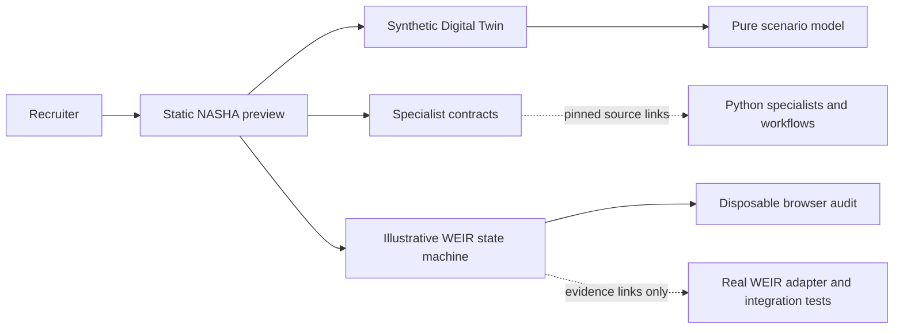

# Architecture and evaluation case study

## Problem and result

A recruiter needs to distinguish an implemented hospitality decision-support system from a cinematic simulation. The existing Command Center exposes specialist contracts; the extension adds inspectable scenario assumptions and an explicit approval lifecycle without claiming live business operations.



Solid edges are browser execution. Dotted edges are evidence navigation, not service calls. THE WEIR is separate from the twelve specialists. They are deterministic callable services, not twelve autonomous LLMs.

## Technical decisions

- **2.5D before WebGL:** CSS grid and perspective create an architectural overview with native accessible zone controls. No GPU render loop, added framework or 3D dependency.
- **Pure model before UI:** scenario arithmetic and policy transitions can be tested without a browser. DOM rendering uses `textContent`, not user-controlled HTML.
- **Explicit states:** pending approval cannot execute; illustrative approval is bound to the exact tool/amount/scope; a changed request denies and consumed approvals cannot replay. This demonstrates a concept without pretending to secure anything in the browser.
- **Progressive disclosure:** recruiter narrative, source links, limitations and research provenance remain visible without JavaScript. Profiles and scenario controls require JavaScript.
- **Pinned evidence:** engineering code links use `2fc1000`, not a moving branch. Existing vendored evidence and original claim guards remain intact.

## Evaluation and reproducibility

Use the existing lockfile and repository Node dependencies:

```sh
npm ci --ignore-scripts
npm run build
npm test
npm run verify:evidence
npx playwright install --with-deps chromium
python3 -m http.server 8000
# in a second shell
node scripts/test-nasha-command-center.js
npm run test:ecosystem
npm run test:browser
npm run test:a11y
npm run test:experience
npm run test:budget
npm run test:weir
npm run test:nasha
```

For a restricted local environment, `TEST_FILE=1 CHROMIUM_PATH=/usr/bin/chromium` routes real repository files through Playwright, as supported by the existing test harness. It does not measure real network or server behavior. The new browser report is in `evidence/browser-acceptance.json`; historical CI verification is in `evidence/baseline-audit.json`.

Backend baseline: CI #132, 368 passed and one skipped Python test, 15/15 deterministic workflow contract checks, Docker success. Those counts are historical backend results, not test counts for the new frontend or model accuracy. New CI status must be checked at the development commit.

## Limits and future work

The Digital Twin is an inspectable synthetic prototype, not a physical or commercial twin. Invented inputs do not estimate demand or profit. Keyword sentiment is deliberately limited. The approval illustration has no identity, crypto, persistent audit, network boundary or real purchase capability. A production integration would require a separately reviewed authenticated backend, real gateway policy, operational data governance and deployment authorization.
