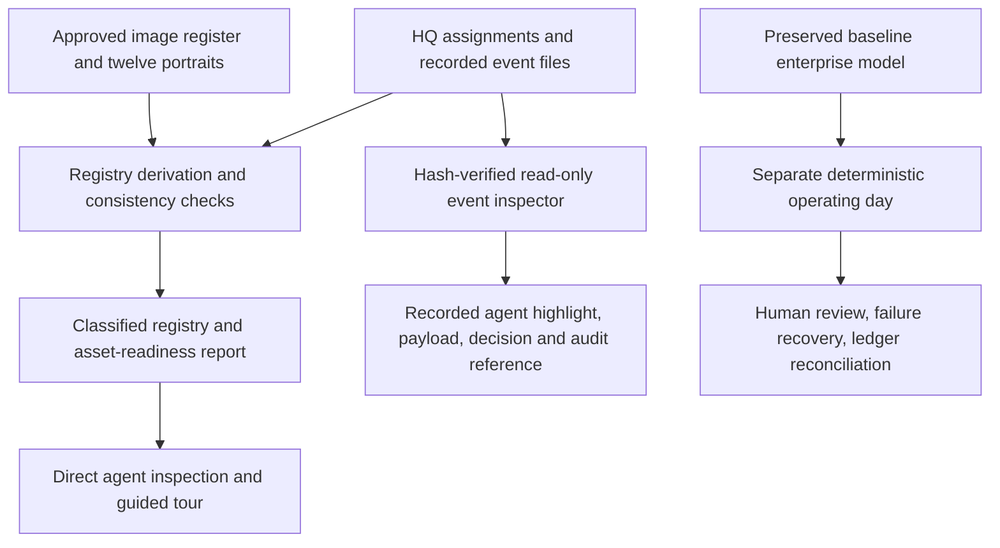

# Agent systems architecture and engineering evidence map

## Implemented review architecture

The review UI does not call an LLM, backend API, email tool, supplier, payment or deployment. It fetches a fixed registry and selected recording file. Next/Previous/Restart/Timeline are read-only navigation; recorded `mode: live` fields are explicitly historical. Every event exposes its original ID, timestamp, responsible agent, payload, evidence refs and hashes. The entire recording hash is checked before display. This is consistency with a pinned reviewed artifact, not proof against a malicious server or production authentication.

## How specialists actually interact

Mission F's declared graph has VECTRA inventory and AETHON demand roots; ZYBREW brewing depends on demand; QUANTIX finance depends on inventory/demand; ECHON customer impact follows finance; SYNAPSE assembles the proposal from their outputs; AEGIS governance follows that proposal; SYNAPSE produces the report after governance. This is a fixed graph in the recorded prototype, not a learned autonomous team.

PYRIX, NOVARA, CORTEX, NEXORA and VERITAS are not forced into Mission F. Their own recorded evidence is available through the registry and scenario selector: culinary recipe/test-pack validation (E); quality/outreach drafts and evidence retrieval (B/C); procurement alternatives (A); and evaluation checks (A–E). Per-agent `recorded_handoffs_from/to` fields preserve the existing aggregate. The UI highlights only the current event's recorded agent and labels other stations as participating or unassigned; chronological adjacency is not falsely labeled as a causal handoff.

The independent eighteen-event browser operating day remains under `baseline/nasha-universe/engineering/#living-enterprise`. It is an authored deterministic visualization, not a faithful reconstruction of every historical assignment. In particular its NOVARA demand and ECHON ticket roles should not redefine their recorded specialties. We do not use that fixture as evidence of additional professional/backend capabilities. It preserves actual synthetic opening/receipt/consumption/waste/adjustment/closing values, explicit approval or rejection, outage refusal, recovery, idempotent receipt and read-only replay. Do not mix that ledger with historical mission quantities.

## Evidence map

Paths are relative to the repository; the registry also supplies immutable GitHub source links pinned to the preserved audit baseline. The new viewer implementation is on the separate draft branch, not falsely attributed to that older commit.

| Concern | Inspectable source/evidence | Classification / limitation |
|---|---|---|
| Twelve identities, roles and assignments | `nasha-universe/living-hq/hq-data.json`, each recording's assignment/task events | Recorded responsibilities; aggregate checked against source events |
| Each tool's input/result | Per-agent `tool_contracts` in `registry.json`, complete `nasha-universe/replays/*.json` | Recorded contracts, not current callable endpoints; representative samples clearly labeled |
| Governance and human decisions | AEGIS policy/approval events, mission rejected/approved recordings | Recorded prototype governance; no claim that browser role selection is production identity |
| Retrieval and failure | CORTEX Mission B, `mission-b-retrieval-outage.json` | Recorded knowledge tool; not live RAG in the website |
| Evaluation and negative controls | VERITAS `evaluation` events; `nasha-universe/research/claimcheck-eval.json`, `claimcheck-p8.json` | Historical evaluation evidence; no blanket all-agent evaluation PASS |
| Model-assisted orchestration | SYNAPSE `model_request/response/validation` in `mission-f-model-assisted-real.json` | Recorded local-model experiment, not rerun or live inference; explanation grounding rejection remains visible |
| Browser inventory model | `nasha-universe/engineering/inventory-model.js` | Implemented deterministic model, demo roles only |
| Operating-day state/replay | `nasha-universe/enterprise-state.js`, `enterprise-ui.js` | Implemented deterministic simulation; hash chains show consistency, not a durable server ledger |
| Model regression tests | `scripts/test-inventory.cjs`, `test-living-enterprise.cjs` | Runnable browser-model unit/negative tests |
| Existing recorded HQ rendering | `nasha-universe/living-hq/hq-app.js`, `hq-events.js` | Implemented recorded-data viewer, not physical animation |
| New registry/inspection | `scripts/twelve-agents/registry.js`, `build_registry.py`, `scripts/test-agent-registry.py`, `test-agent-registry-browser.cjs` | Implemented isolated review and its checks |
| Artwork provenance | `data/image-register.json`, twelve portrait hashes | Existing approved AI-generated 2D concepts; unchanged |
| Portfolio evidence | `nasha-universe/engineering/`, `recruiter.html`, four approved PDFs | Independent projects remain separate from employment |

The Python backend, private service source, live API credentials and production hosting for the recorded agent functions are not included in the current portfolio repository. Existing source references inside recordings are historical references, not evidence of locally available code. No source availability, deployment, business result or professional employment claim is fabricated to fill that gap.
